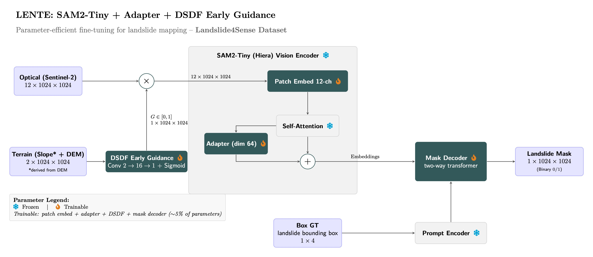

# LENTE: Landslide Early-fusion Neural Transformer Engine 🏔️🔍

## 📖 Abstract

Accurate landslide segmentation is critical for disaster response, but multispectral imagery often suffers from spectral ambiguity. Furthermore, utilizing Vision Foundation Models (VFMs) for Earth Observation is hindered by their computational bloat and native restriction to 3-channel RGB inputs. 

We introduce **LENTE** (Landslide Early-fusion Neural Transformer Engine), a parameter-efficient architecture that adapts the **SAM2-Tiny model** for multimodal geospatial data. LENTE utilizes a **Zero-Delta patch embedding** to ingest 12-channel optical data without collapsing pre-trained priors, coupled with a **Dual-Stage DEM-guided Fusion (DSDF) module** that physically constrains optical features using topographic spatial gating. 

By injecting zero-initialized bottleneck adapters into a frozen backbone, LENTE updates less than 5% of the network parameters, ensuring **edge-computing viability**. Evaluations on the **Landslide4Sense and Bijie datasets** demonstrate that LENTE establishes a new state-of-the-art, achieving Landslide IoUs of **75.01%** and **92.84%** while significantly outperforming heavier and fully-trained architectures.

## 💻 Hardware Efficiency

A full end-to-end fine-tuning of a Vision Foundation Model traditionally requires enterprise-grade multi-GPU clusters. By explicitly designing LENTE around a Parameter-Efficient Fine-Tuning (PEFT) strategy, the model trains less than **5% of its total parameters**.

All training and experimentation for this architecture were successfully executed on a single consumer-grade workstation equipped with:

* **GPU:** 1x NVIDIA GeForce RTX 3090 (24 GB VRAM)

* **RAM:** 64 GB DDR4

## 🏗️ System Architecture



LENTE modifies the SAM2 vision pipeline through specific, engineered components:

### 1. Multimodal Patch Embedding (Zero-Delta Strategy)

Standard foundation models accept only 3-channel (RGB) inputs. For multispectral datasets (e.g., Sentinel-2), LENTE expands the patch embedding to 12 channels.

* The pre-trained RGB weights are copied over exactly.

* The extra non-visible channels are initialized with a strictly small amount of Gaussian noise ($\mu=0, \sigma=0.001$) to ensure training stability and prevent catastrophic forgetting (Zero-Delta).

* *Note: For standard RGB datasets, this expansion is disabled, and the native 3-channel embedding is simply unfrozen.*

### 2. DSDF Early Guidance Module (Terrain Fusion)

Topography dictates landslide mechanics. Rather than concatenating elevation data, LENTE employs an early-stage physics-informed guidance module.

* A 2-channel terrain tensor (Slope + DEM) is processed through `Conv3x3 + BN + ReLU -> Conv1x1 + Sigmoid` to generate a dynamic spatial gain $G \in [0, 1]$.

* The optical input is modulated by this gain ($X'_{opt} = X_{opt} \odot G$).

* Because this occurs at the early stage, the terrain physically guides the encoder to focus on susceptible regions without direct channel concatenation.

### 3. Parameter-Efficient Attention Adapters

To adapt the network without destroying foundational priors, the core SAM2-Tiny (Hiera) encoder is kept **FROZEN**. Instead, bottleneck Adapters are injected into every attention block.

* **Architecture:** Down-projection to a bottleneck dimension of 64 $\rightarrow$ ReLU activation $\rightarrow$ Up-projection back to the original dimension with a residual bypass connection.

* **Zero-Initialization:** The up-projection weights are strictly zero-initialized, ensuring the model begins training acting exactly like a standard SAM2 model.

* **Trainable Parameters:** Only the patch projection, adapters, DSDF early guidance, and mask decoder are updated. The prompt encoder remains untouched.

### 4. Rigorous Training Protocol

* **Split & Augmentation:** Stratified 60/20/20 split (seed=42) with offline and on-the-fly augmentations (horizontal/vertical flip, rotate 90) applied to positive samples.

* **Data Curation:** To focus specifically on segmentation accuracy, `pos_weight` is dynamically calculated based on dataset statistics to handle extreme foreground/background imbalances.

## 📊 Supported Datasets

LENTE natively supports execution on multiple datasets using distinct optical/terrain formulations:

### 1. Landslide4Sense (L4S) Benchmark

* **Inputs:** 12-channel Sentinel-2 multispectral + 2-channel (DEM + Slope).

* **Adaptation:** Utilizes the full **Zero-Delta** patch expansion to $C=12$.

* **Scripts:** `LENTE_train.py`, `LENTE_test.py`, `LENTE_viz.py`, `LENTE_livestream.py`

### 2. Bijie Landslide Dataset

* **Inputs:** 3-channel RGB (TripleSat) + DEM only.

* **Adaptation:** Slope is calculated dynamically via spatial gradients ($S = \sqrt{(\nabla_x \text{DEM})^2 + (\nabla_y \text{DEM})^2}$). Zero-Delta expansion is disabled; SAM2's native 3-channel patch projection is utilized and unfrozen.

* **Scripts:** `LENTE_train_bijie.py`, `LENTE_test_bijie.py`, `LENTE_viz_bijie.py`

## 🚀 Advantages Compared to State-of-the-Art (SOTA)

### 1. vs. TransLandSeg (SAM Adaptation)

* **SOTA Architecture:** TransLandSeg utilizes a massive, frozen SAM ViT-L encoder with Adaptive Transfer Learning (ATL) layers.

* **SOTA Limitation:** Its input is restricted strictly to 3-band RGB images, meaning it completely lacks DEM fusion.

* **LENTE Advantage:** By incorporating early DEM guidance and adapting the much lighter SAM2-Tiny backbone, our model achieves a massive **+21.6 percentage point** improvement in Landslide IoU over TransLandSeg (75.01% vs 53.41%).

### 2. vs. TriGEFNet (Tri-Stream Architectures)

* **SOTA Architecture:** TriGEFNet processes data using three entirely independent parallel streams (RGB, Slope/DEM, and a Vegetation Index like NDVI/EVI).

* **SOTA Limitation:** Because each stream has its own encoder, there is no premature fusion of low-level features.

* **LENTE Advantage:** LENTE's approach of modulating the optical input *before* the single transformer encoder allows it to outperform TriGEFNet's IoU by **+12.5 percentage points**.

### 3. vs. D2FLS-Net

* **SOTA Architecture:** D2FLS-Net utilizes a Swin-Transformer for its RGB backbone and a ViT-style encoder for DEM data.

* **LENTE Advantage:** While D2FLS-Net achieves a 56.69% Landslide IoU, our model leverages the foundational pre-training of SAM2 alongside a more highly optimized early-guidance terrain fusion to vastly surpass its accuracy.

## 📈 Performance Summary (Landslide4Sense Test Set)

*(Evaluated on real metrics from the 60/20/20 test split)*

| **Model** | **Landslide IoU** | **mIoU** | **F1-Score** | **Precision** | **Recall** | 
| **TransLandSeg** | 53.41% | 75.99% | 84.46% | 84.99% | 83.93% | 
| **D2FLS-Net** | 56.69% | 77.64% | n.r. | 68.45% | 76.87% | 
| **TriGEFNet** | 62.51% | 80.26% | 76.88% | 75.33% | 78.54% | 
| **LENTE (Ours)** | **75.01%** | **86.83%** | **84.33%** | **81.15%** | **88.05%** | 

*(Note: Our model demonstrated stable convergence during training, dropping from a train loss of 0.31 to 0.12 over 100 epochs with no overfitting, and achieved an IoU background score of 98.65%.)*

## 🛠️ Installation & Setup

1. **Install dependencies:**
   Ensure you have the required packages installed in your Python environment:

   ```pip install torch torchvision transformers segmentation-models-pytorch tqdm albumentations pillow pyyaml h5py opencv-python matplotlib```

2. **Configuration:**
The repository uses a `config.yaml` file to manage paths and hyperparameters. Ensure your dataset paths are correctly pointed in your configuration file before running the scripts.

## 🏃‍♂️ Usage

LENTE is operated entirely via a suite of modular scripts depending on the target dataset.

### For the Landslide4Sense Dataset (14-Channel)

* **Train:** `python LENTE_train.py` (Automatically handles splits, augmentations, and saves timestamped checkpoints)

* **Test:** `python LENTE_test.py` (Evaluates the best checkpoint on the test split)

* **Visualize:** `python LENTE_viz.py` (Generates RGB vs. Ground Truth vs. Prediction error maps)

* **Livestream:** `python LENTE_livestream.py` (Simulates a real-time OpenCV inference stream, e.g., for Jetson Orin Nano deployment)

### For the Bijie Landslide Dataset (RGB + DEM)

* **Train:** `python LENTE_train_bijie.py`

* **Test:** `python LENTE_test_bijie.py`

* **Visualize:** `python LENTE_viz_bijie.py`